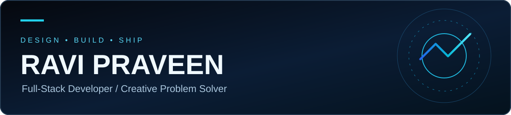
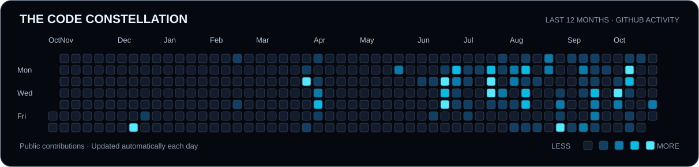

<div align="center">



### Turning ideas into experiences that people love using.

**Full-Stack Development** · **Mobile Applications** · **Thoughtful UI/UX**

[**Portfolio ↗**](https://ravi-praveen.vercel.app/) &nbsp;•&nbsp; [**LinkedIn ↗**](https://www.linkedin.com/in/ravi-praveen-7p200727/) &nbsp;•&nbsp; [**Email me ↗**](mailto:raviaiyathurai354@gmail.com)

</div>

---

## ✦ Behind the code

```typescript
const ravi = {
  name: "Ravi Praveen",
  location: "Sri Lanka 🇱🇰",
  focus: ["Full-stack applications", "Mobile apps", "UI/UX"],
  technologies: ["PHP", "React", "JavaScript", "SQL", "Flutter"],
  philosophy: "Build with purpose. Polish the details. Keep learning."
};
```

I'm a software engineering student and full-stack developer who enjoys bringing together **clear design, reliable engineering, and practical problem-solving**. I care about interfaces that feel intuitive and codebases that are easy to maintain.

## ◈ Tools & technologies

| Area | Technologies |
|:--|:--|
| **Frontend** | HTML · CSS · JavaScript · React · Bootstrap · Tailwind |
| **Backend & databases** | PHP · Node.js · MySQL · SQL |
| **Mobile** | Flutter · Dart |
| **Design & workflow** | Figma · Git · GitHub · VS Code · Vercel |

<sub>Technologies I work with, study, or explore — not a claim of expert proficiency in every tool.</sub>

## ◇ Selected work

| Project | Description |
|:--|:--|
| 🌐 [**Personal Portfolio**](https://ravi-praveen.vercel.app/) | An introduction to my projects and development journey. |
| 💸 [**MoneyPilot**](https://github.com/RaviPraveen/MoneyPilot) | Software project from my public portfolio. |
| 📱 [**Mobile Billing App**](https://github.com/RaviPraveen/Flutter-Mobilebilling-app) | Flutter-based mobile application project. |
| 🛒 [**Individual Project**](https://github.com/RaviPraveen/Individual-Project) | A hands-on development project. |

<div align="center">

[**Explore more repositories →**](https://github.com/RaviPraveen?tab=repositories)

</div>

## ✦ The Code Constellation

<div align="center">

*My public GitHub activity over the rolling last 12 months.*

<a href="https://github.com/RaviPraveen?tab=overview"></a>

<sub>Updated daily from GitHub's own contribution data. The chart is generated and stored in this repository, not loaded from a third-party image service.</sub>

</div>

## ✨ What drives me

| Curiosity 💡 | Craft 🛠️ | Impact 🚀 |
|:--:|:--:|:--:|
| Keep learning | Design, build, refine | Make useful software |

## ☕ Let's connect

<div align="center">

**Have an idea worth building? I'd love to hear about it.**

[**Send an email**](mailto:raviaiyathurai354@gmail.com) &nbsp;•&nbsp; [**Connect on LinkedIn**](https://www.linkedin.com/in/ravi-praveen-7p200727/) &nbsp;•&nbsp; [**Visit my portfolio**](https://ravi-praveen.vercel.app/)

---

<sub>Built with curiosity, persistence, and attention to detail · Ravi Praveen</sub>

</div>
